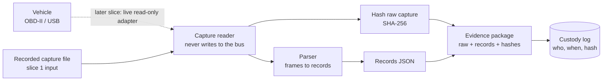

# Architecture: first vertical slice

The simplest complete version: read a recorded OBD-II capture file (lines of timestamped CAN frames), parse the frames into records, and write an evidence package with a SHA-256 hash and a custody log. No vehicle or hardware needed.

## Layers after slice 1

1. Live read-only capture from a USB OBD-II adapter on a test vehicle or bench ECU.
2. Vehicle profiling: identify make and model year from standard diagnostic responses and pick an extraction profile.
3. Infotainment extraction over USB for paired devices and location history, one manufacturer first.
4. Timing harness that measures time to extract against the 15-minute and 5-minute goals.

## Design decisions

### 1. Read-only by design

- **Constraint:** non-destructive extraction with forensic integrity.
- **Reasoning:** if the capture layer has no code path that sends write or reset requests, it cannot alter the vehicle's state.
- **Rejected alternative:** a general diagnostic tool that can also clear codes. More useful for mechanics, but one wrong call alters evidence.
- **What breaks otherwise:** extracted data loses its evidentiary value.

### 2. Hash the raw capture before parsing

- **Constraint:** verifiable accuracy and a defensible chain of custody.
- **Reasoning:** the raw bytes are the evidence; parsed records are an interpretation. Hashing raw first lets anyone re-parse and check.
- **Rejected alternative:** hash only the parsed output. Smaller, but a parser bug would be indistinguishable from tampering.
- **What breaks otherwise:** no way to prove the records came from that vehicle unchanged.

### 3. Start from recorded captures, not live hardware

- **Constraint:** Phase I is a feasibility study on a small budget.
- **Reasoning:** recorded files make parsing and evidence handling testable on any laptop and repeatable in tests.
- **Rejected alternative:** buy adapters and a test vehicle first. Realistic, but slows every iteration.
- **What breaks otherwise:** software bugs get mixed up with hardware and wiring problems.

### 4. Python first, embedded port later

- **Constraint:** the objective is a pocket-sized device, but Phase I only needs projected speeds.
- **Reasoning:** prototype the logic in Python, measure it, then port the hot paths to C or Rust for the device.
- **Rejected alternative:** write firmware for target hardware from day one. Closer to the end state, slower to learn.
- **What breaks otherwise:** hardware choices get locked in before the data path is understood.
